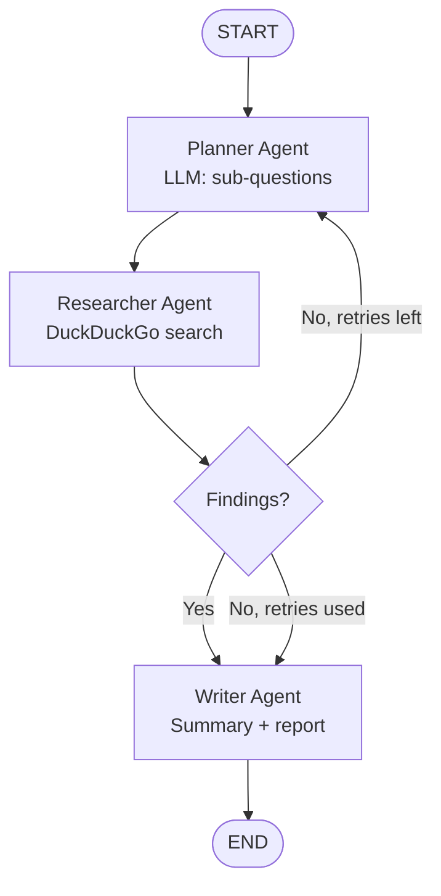

# LangGraph Multi-Agent AI Research Assistant

> **LangChain + LangGraph agentic AI project**: a supervisor-style multi-agent system — planner, researcher, and writer agents — that turns any research question into a cited Markdown report. Runs fully offline with zero API keys, or live with free DuckDuckGo search and OpenAI.

[](https://www.python.org/downloads/)
[](https://langchain-ai.github.io/langgraph/)
[](https://www.langchain.com/)
[](LICENSE)
[](#testing)

## What this project does

Ask a question, get a researched answer — with sources. The **LangGraph multi-agent research assistant** plans the research, searches the web, and writes a cited report:

- **Planner agent** — breaks your question into focused sub-questions.
- **Researcher agent** — searches the web (free DuckDuckGo, no API key) and dedupes results by URL.
- **Writer agent** — writes an executive summary and renders a Markdown report with numbered citations `[1]`, `[2]`, `[3]` linked to real sources.
- **Supervisor retry** — if a search round returns nothing, the supervisor retries once with the raw question before the writer reports "no sources found" — it never invents facts.

## Why this project is different

- **Zero-cost demo** — the default run uses a deterministic mock LLM and mock search: no OpenAI key, no network, no cost. The whole pipeline still runs end to end.
- **Real agentic AI, not a script** — a compiled LangGraph `StateGraph` with conditional edges, shared state, and a retry loop.
- **Verified, not vibe-checked** — 36 pytest tests, all passing, covering every agent, the full graph, empty-search retries, and the CLI. The demo produces a real report file you can read.

## Architecture



**Project structure**

```text
langgraph-research-assistant/
├── src/research_assistant/
│   ├── __init__.py        # public API
│   ├── cli.py             # command-line interface
│   ├── config.py          # settings from environment
│   ├── state.py           # LangGraph TypedDict state
│   ├── llm.py             # MockLLM (offline) + OpenAILLM (live)
│   ├── search.py          # DuckDuckGo + mock search clients
│   ├── agents.py          # planner / researcher / writer nodes
│   ├── graph.py           # StateGraph wiring + retry routing
│   └── report.py          # cited Markdown rendering
├── examples/
│   └── demo.py            # offline demo, writes outputs/demo_report.md
├── tests/                 # pytest suite (34 tests)
├── requirements.txt       # pinned dependencies
└── pyproject.toml         # packaging + pytest config
```

## Installation

Requires **Python 3.10+**.

```bash
git clone https://github.com/murtazamahboob/langgraph-multi-agent-research-assistant.git
cd langgraph-multi-agent-research-assistant

python -m venv .venv
source .venv/bin/activate        # Windows: .venv\Scripts\activate

pip install -r requirements.txt
pip install -e .                 # installs the `research-assistant` command
```

## Usage

### Offline demo (no API key, no network)

```bash
python examples/demo.py
```

Writes `outputs/demo_report.md` and prints the plan, source count, and a report preview.

### Command line

```bash
# Offline (default): mock LLM + mock search
research-assistant "What is LangGraph and how does it work?"

# Real DuckDuckGo search, still with the mock LLM (free, no key needed)
research-assistant "What is LangGraph?" --live-search

# Fully live: real search + real OpenAI model (needs OPENAI_API_KEY)
export OPENAI_API_KEY="sk-..."
research-assistant "What is LangGraph?" --live

# Custom output file
research-assistant "AI agents in healthcare" --output reports/healthcare.md
```

> Without the editable install, the same commands work as
> `PYTHONPATH=src python -m research_assistant.cli ...`.

### Use it as a library

```python
from research_assistant import MockLLM, MockSearchClient, run_research

final_state = run_research(
    "What is LangGraph?",
    MockLLM(),
    MockSearchClient(),
)
print(final_state["report"])
```

## Example output

Running the offline demo produces `outputs/demo_report.md`:

```markdown
# Research Report: What is LangGraph and how does it work?

## Executive Summary

This report answers 'What is LangGraph and how does it work?' using
3 sources. The findings below cover the definition and core concepts,
how the topic works in practice, and the latest developments. Every
claim is tied to a numbered citation in the sources list.

## Key Findings

### What is LangGraph and how does it work? — overview and core concepts [1]

An overview of What is LangGraph and how does it work?, covering its
definition, core concepts, and why it matters.

_Source: https://example.com/research/overview_

## Sources

[1] What is LangGraph and how does it work? — overview and core concepts — https://example.com/research/overview
[2] How What is LangGraph and how does it work? works in practice — https://example.com/research/how-it-works
[3] What is LangGraph and how does it work? — latest developments and use cases — https://example.com/research/latest
```

## Tech stack

| Layer | Technology |
|---|---|
| Agent orchestration | LangGraph 1.2 (StateGraph, conditional edges) |
| LLM framework | LangChain Core 1.7, LangChain OpenAI 1.7 |
| Web search | DuckDuckGo via `ddgs` (free, no API key) |
| Language | Python 3.10+ (typed, dataclasses, TypedDict) |
| Testing | pytest 9 (34 tests, 100% of agents covered) |

## Configuration

| Environment variable | Default | Purpose |
|---|---|---|
| `OPENAI_API_KEY` | — | Enables the real OpenAI model with `--live` |
| `RA_MODEL` | `gpt-4o-mini` | Model used by the live LLM |
| `RA_MAX_RESULTS` | `3` | Max search results per sub-question |
| `RA_MAX_RETRIES` | `1` | Supervisor retries on empty search |
| `RA_OUTPUT_DIR` | `outputs` | Default report output directory |

## Testing

```bash
pytest -v
```

The suite covers the mock and real LLM factories, both search clients
(including a simulated network failure), every agent node, the full
compiled graph (happy path, empty-search retry, determinism), report
rendering and citations, and the CLI end to end. **36 tests, all passing.**

## Roadmap

- [ ] Streamlit web UI for asking questions in the browser
- [ ] Vector-memory: remember past research across runs
- [ ] Multi-model support (local models via Ollama)
- [ ] PDF export of the final report

## Contributing

Contributions are welcome! Fork the repo, create a feature branch,
add tests for your change, make sure `pytest` passes, and open a pull
request. Please keep the offline demo working with no API key.

## License

MIT — see [LICENSE](LICENSE).
